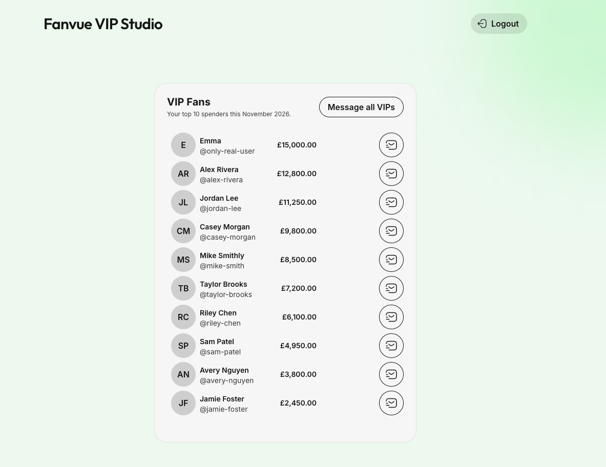
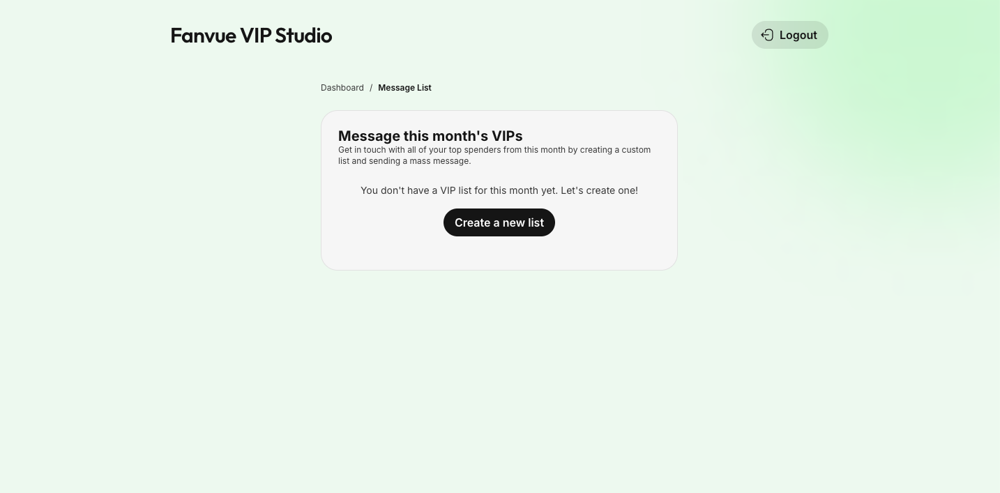
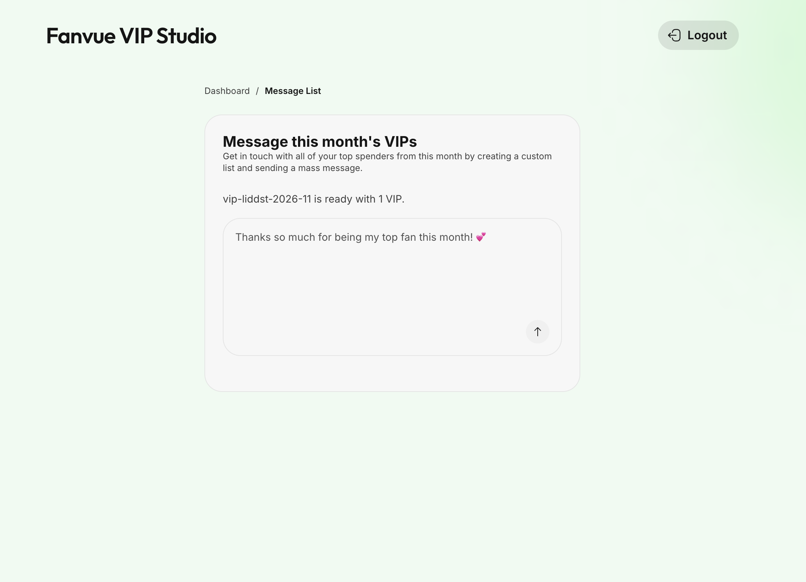
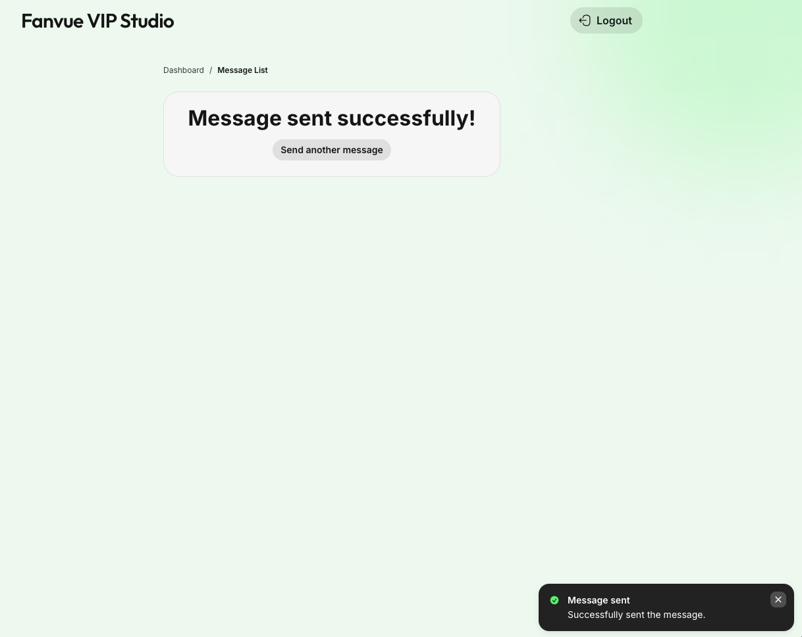
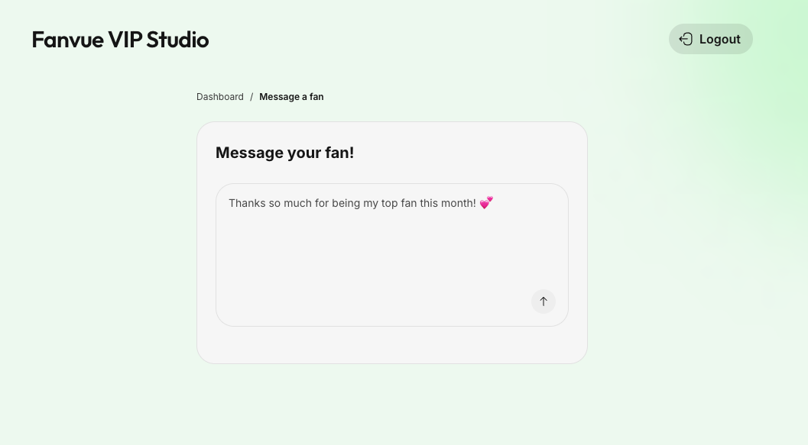
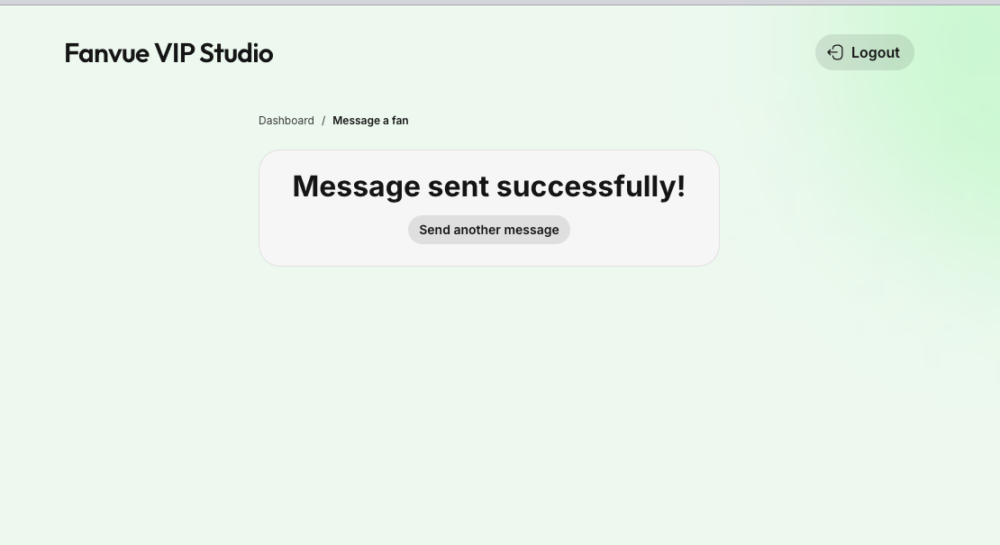

# Fanvue VIP Studio ✨
### Branched off of the Fanvue App Starter

## Requirements

- pnpm
- Node 18+
- An existing Fanvue App from [Fanvue Developer Area](https://fanvue.com/developers/apps) (client id/secret). 

## Setup

1. Create `.env.local` using `.env.example`

2. Install deps and run:

```bash
pnpm install
pnpm dev
```

3. Set up HTTPS for local development:

#### Using [portless](https://github.com/vercel-labs/portless) (Recommended)

Portless gives you stable, named `.localhost` URLs with automatic HTTPS/HTTP2 — no manual cert generation or hosts file editing.

```bash
npm install -g portless
```

One-time setup (generates and trusts certs automatically):

```bash
portless proxy start --https
```

Update your `package.json` dev script:

```json
{
  "scripts": {
    "dev": "portless run next dev"
  }
}
```

Then run:

```bash
pnpm dev
# -> https://fanvue-app-example.localhost
```

Now set your redirect URI in the Fanvue UI to match:

```
https://fanvue-app-example.localhost/api/oauth/callback
```

---

## Process & what I built 

Before beginning to build anything for this challenge, I took some time to understand how the app store worked, what features Fanvue already has on offer, what is available from the API today, and what possible gaps there could be. I ran through some creator & fan interactions by creating accounts and interacting between them. I also did some competitor analysis to familiarize myself with what kinds of features users may be expecting when coming to Fanvue (ie. on Patreon & OF). One thing I saw was that loyalty programs, rewards tiers & interacting with top fans - and saw that there was a gap for this on Fanvue. 

The insights dashboard is pretty extensive and a creator can get month by month data & top spender data, however there is no way to interact with the top spenders in a month as a group out of the box. A creator would have to manually take that step to create lists & message fans.

So, I thought putting together a top fans (VIPs) of the month app could help creators interact with & reward their top spenders faster with messages or exclusive content. I wanted to build something straightforward and scalable that could be the foundation for this app.

---

### Dashboard
After logging into the app through the Fanvue OAuth, you are taken to a Dashboard which displays top 10 spenders for the current month. Users can either choose to message the VIPs as a group, or individually. (This uses mocked this data)



### Message list - no list exists 

On Fanvue, the only way to send a mass message is through a list. If this is the first time coming to this page, the user is prompted if they would like to create a list.



### Message list - list exists 

Once the list is created, a chat prompt appears where the user can craft a message to their list an send it. 



Once sent, a success screen appears and the message will have successfully been shared in the app. 




### Message a fan 

From the dashboard, users can also message individual fans directly. The CTA next to each user takes you to a page with text prompt. 




Once they have sent the message, a success screen appears and the message will have been shared to this user. 



## Full video walkthrough

If you want to watch a full demo: https://www.loom.com/share/2dece1dc1fcf4e09a61b39c8672209d6 


### Technical pieces
- Hits the fanvue API for GET & POST custom lists, fans, etc.
- Utilizes Fanvue UI components
- Essential seed data for demoing and testing locally when you don't actually have any paying fans 

## Future app expansion ideas

This is super scalable with a lot of different directions it could go in, here are some ideas I have thought of if I was to spend more time. 
- This is only for the current month, so access to previous/future months would be a big improvement. 
- Store and display if you have already messaged the month group, and what those messages were. Along with the data from the mass messages insights. 
-  Create a leaderboard over time to tell who your top fans are month by month
- A percentile ranking that could be autoshared with users (ie. You are in the top .01% of fans)
- Notification for the creator that the end of month list has been finalized and you have a top fan of the month. 

Message an individual fan page: 
- Expand this page to display full chat window with chat history 
- Show on the dashboard if there are new messages from that user 
- Display more fan details (name etc.) 

General messaging: 
- Schedule automatic messages to go out to top fan or whole top 10 at the end of the month 
- Enhance with access to templates, vault, and AI suggestions to prompt messages

Technical
- CI/CD to actually deploy it to the store 
- More testing & edge case handling for if there aren't enough users


### Thank you!
Okay, if you have read this far thank you so much for the time. Was fun to dig deep into Fanvue and work to understand what might be useful to a creator. I appreciate the time and consideration and hope to hear back soon! 
😊 Emma 